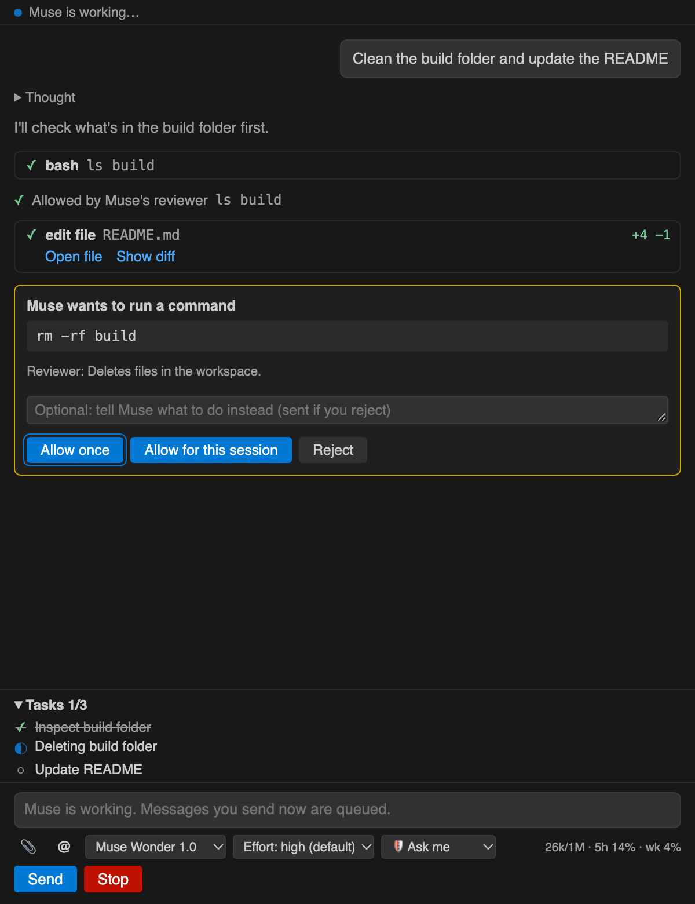
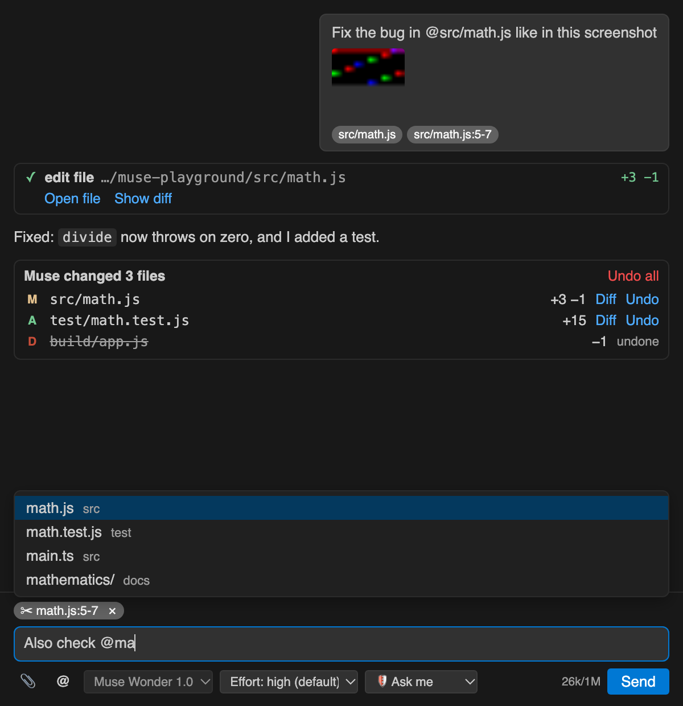

# Muse Studio for VS Code (Unofficial)

A Claude Code-style side panel for the Muse Code agent: chat, approvals, @-mentions, images, and review/undo of every change.



> **Community project.** This extension is not made, endorsed or supported by Meta. "Muse" and "Muse Code" are Meta's names for their product. This extension only runs the `muse` CLI you have installed.

## Features

- **Chat panel:** Muse's replies stream in as markdown. Its progress notes and thinking summaries are shown too.
- **@-mentions:** type `@` to attach files or folders to your message.
- **Editor context:** your open file and selected code go along with the message (remove it per message with ×).
- **Images:** paste, drop or attach screenshots.
- **Review and undo:** after each run, a card lists every file Muse changed, with **Diff** and **Undo** per file and **Undo all** (git repositories).
- **Approvals:** when Muse wants to do something restricted (a protected file, a new network target, anything outside the sandbox), an **Allow / Reject** card appears, with an optional note for Muse. Every decision shows who made it: you, your rules, or Muse's reviewer.
- **Permission profiles:** *Ask me* (default: you approve restricted actions), *Auto-review* (Muse's AI reviewer approves what it judges safe and asks you otherwise), *Read only*, or *Unrestricted*. Edits inside the open folder are allowed in *Ask me* and *Auto-review*.
- **Questions:** when Muse needs a decision from you, it asks with clickable options.
- **Model and effort pickers** right in the panel. Contributor models (cheaper, but Meta may train on your sessions) are labeled.
- **Tool cards** for every command, file read and edit, with output, +/− line counts, and **Open file / Show diff** for edits.
- **Task list, context meter and quota meter** (5-hour and weekly allowance).
- **Stop** interrupts Muse cleanly (or press Esc). Messages sent while Muse is working are queued.
- **Chats resume:** pick an earlier chat from the history button and Muse continues where it left off.
- **Shortcuts:** Cmd+Alt+M (Ctrl+Alt+M) opens the chat; Cmd+Alt+L (Ctrl+Alt+L) or the right-click menu adds selected code.



## Requirements

The Muse Code CLI, signed in. If it's missing or you're signed out, the panel shows a setup card with buttons to install it (Meta's installer, run in a terminal you can see), sign in with `muse login`, or save an API key.

The panel looks for `muse` on PATH and in `~/.local/bin`, where the installer puts it. If it's somewhere else, use **Choose the muse file…** or set **muse.path**.

## Settings

| Setting | Purpose |
| --- | --- |
| `muse.path` | Path to the `muse` CLI (default `muse`) |
| `muse.permissionProfile` | What Muse may do without asking, for new chats (also in the panel) |
| `muse.model` | Model for new chats (also in the panel) |
| `muse.reasoningEffort` | Default effort, `none` … `ultra` (also in the panel) |
| `muse.provider` | `meta`, or `echo` to try the panel free, without model calls |
| `muse.preset` | Agent preset (`--preset`) |
| `muse.sendEditorContext` | Send the open file and selection with messages (default on) |
| `muse.trackChanges` | Snapshot git workspaces so changes can be reviewed and undone (default on) |
| `muse.extraArgs` | Extra arguments for `muse serve` |

## How it works

The panel runs `muse serve` and talks to it over the Muse Session Protocol (MSP), the same JSON-RPC protocol the CLI exports with `muse schema generate-ts`. One `muse serve` process is kept running per VS Code window.

## Known limitations

- **Edits inside the open folder aren't asked about** in *Ask me* or *Auto-review*; that's how Muse's profiles work. Use *Read only* to prevent edits.
- **Changes are written straight to disk**, then listed for review. Undo needs a git repository; outside one, the panel can only diff against nothing.
- **Undo restores raw file contents.** In repositories that use git filters (Git LFS, line-ending conversion), undone files may need a `git checkout` to look normal again.
- **Some protocol features are marked experimental** by Meta and may change between Muse releases. Unknown message types are ignored; **Muse: Show Log** shows Muse's own log output.

## Development

```sh
npm install
npm run build      # bundle to dist/
npm test           # tests: a fake `muse serve` plus captured real traffic in test/fixtures/real
npm run package    # build a .vsix
```

Press F5 in VS Code with this folder open to launch an Extension Development Host.

